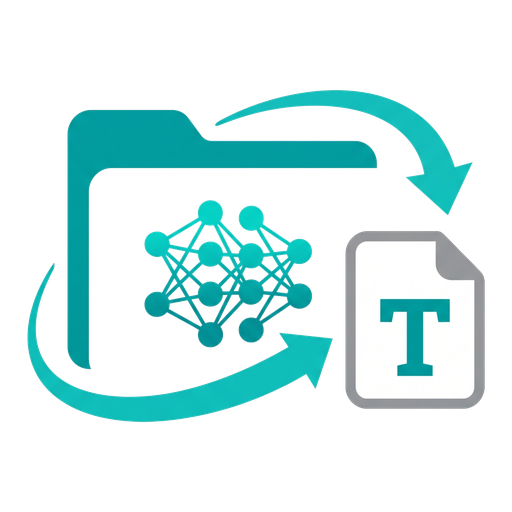
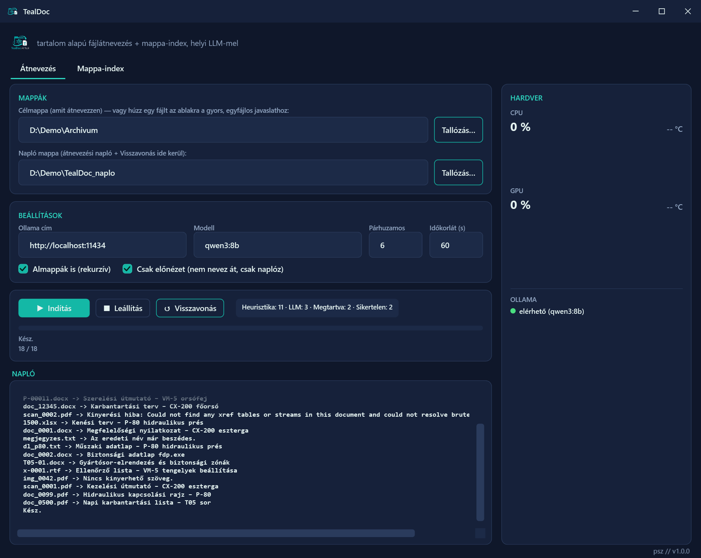
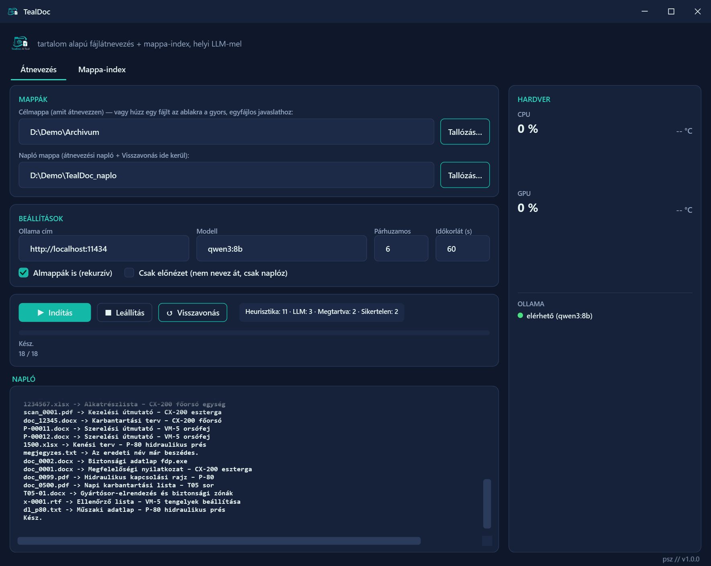
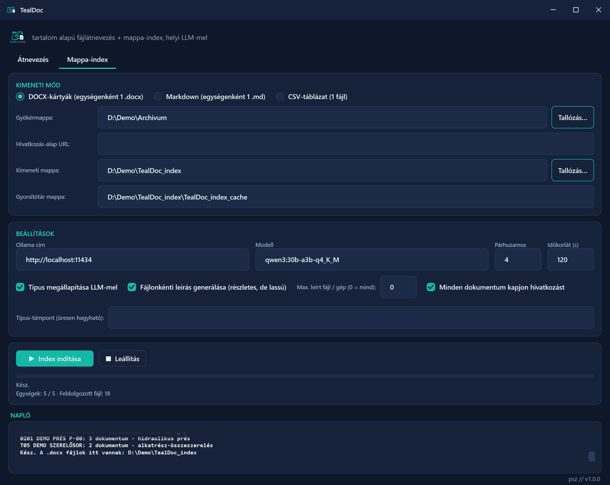
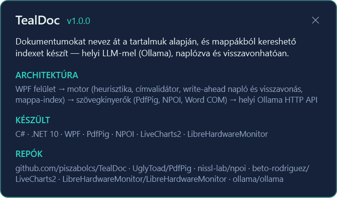
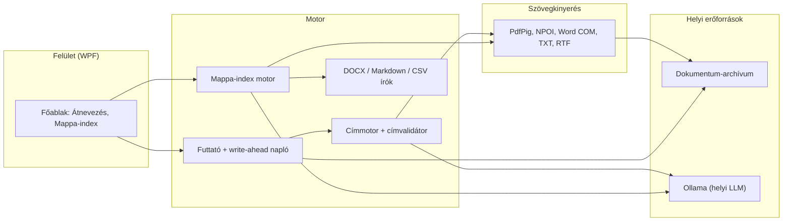

<div align="center">



# TealDoc

**Beszédes fájlnevek és kereshető mappa-index dokumentumokból, helyi LLM-mel**


[Funkciók](#funkciók) · [Képernyőképek](#képernyőképek) · [Architektúra](#architektúra) · [Telepítés](#telepítés)

</div>

> [!NOTE]
> **English summary.** TealDoc is a Windows desktop app that renames documents by their content (`scan_0001.pdf` becomes `Operating manual - CX-200 lathe (scan_0001).pdf`) and turns a document archive into searchable per-folder cards, using a local LLM through Ollama. It is built for maintenance and engineering teams in a manufacturing plant whose machine documentation is full of meaningless file names. Every rename is logged before it happens and can be undone; the interface is Hungarian.

<p align="center">
  
</p>

## A probléma

Egy gyártóüzem gép- és berendezés-dokumentációja évek alatt vak nevű fájlokból álló archívummá nő: `scan_0001.pdf`, `P-00012.docx`, `1234567.xlsx`. Egy kezelési útmutatót vagy kenési tervet csak a fájlok egyenkénti megnyitásával lehet megtalálni, és a mappákból nem derül ki, melyik gépről milyen dokumentum van meg. A belső anyagokat ráadásul nem célszerű felhős szolgáltatásnak átadni.

## A megoldás

A TealDoc a fájl tartalmából javasol beszédes nevet: előbb ingyenes heurisztikával (a PDF legnagyobb betűs sora, a DOCX első bekezdése, az XLSX első cellája), és csak ha ez kevés, a gépen futó Ollama LLM-mel. Minden javaslatot szigorú címvalidátor szűr, minden átnevezés előbb a naplóba kerül, és visszavonható. A Mappa-index egy archívum almappáiból (gép, berendezés, gyártósor) egységenként DOCX-kártyát, Markdown-fájlt vagy egyetlen CSV-táblázatot készít, rövid fájlonkénti leírással.

## Funkciók

- **Átnevezés tartalom alapján.** `scan_0001.pdf` → `Kezelési útmutató - CX-200 eszterga (scan_0001).pdf`; az eredeti név zárójelben megmarad, így cikk- vagy rajzszámra továbbra is kereshető.
- **Lépcsőzetes címkeresés.** Heurisztika, helyi LLM, majd zárt listás típus-osztályozás; a validátor kiszűri az elérhetőségeket, a betűkupacot, a jogi láblécet és a láthatatlan karaktereket, a már beszédes nevű fájlhoz pedig nem nyúl.
- **Előnézet alapból.** Az első futás csak naplóz, semmit nem nevez át, így a javaslatok átnevezés előtt átnézhetők.
- **Write-ahead napló és visszavonás.** Minden átnevezés az áthelyezés előtt kerül a CSV-naplóba; a Visszavonás a legutóbbi vagy minden futást visszaállítja.
- **Egyfájlos gyors mód.** Egy fájlt az ablakra húzva megjelenik a javasolt név, Enterre átnevezi és naplózza.
- **Mappa-index.** Egységenként azonosító, név, LLM-mel megállapított típus és fájlonkénti leírás, opcionálisan webes hivatkozással (pl. SharePoint-dokumentumtár) minden dokumentumra; a megszakadt futás a gyorsítótárból folytatódik.
- **Hibatűrés.** Egy zárolt vagy sérült fájl nem állítja le a köteget; a Mappa-index induláskor ellenőrzi az Ollamát, és három egymás utáni időtúllépés után nem vár tovább.
- **Hardverpanel.** CPU- és GPU-terhelés, valamint az Ollama elérhetősége a főablak oldalsávjában.

Támogatott formátumok: PDF, DOCX/DOCM, DOC (Microsoft Word kell hozzá), XLSX/XLSM/XLS, TXT/CSV (UTF-8, UTF-16, Windows-1250), RTF.

## Képernyőképek

<table>
  <tr>
    <td align="center" width="50%"><br/><sub>Éles átnevezés: a napló minden javaslatot és eredményt mutat</sub></td>
    <td align="center" width="50%"><br/><sub>Mappa-index: egységenkénti DOCX-kártyák típussal és leírással</sub></td>
  </tr>
  <tr>
    <td align="center" width="50%"><br/><sub>Névjegy a lábléc <code>psz // v1.0.0</code> feliratáról</sub></td>
    <td width="50%"></td>
  </tr>
</table>

A képek egy kitalált demó-archívumon készültek, a valódi felület képernyőn kívüli renderelésével, egy helyi, szabályalapú hamis Ollama-végponttal; a hardverpanel ilyenkor nem mér.

## Architektúra



A WPF felület két munkafolyamatot indít. Az átnevezés futtatója a címmotortól kér nevet, a címmotor a szövegkinyerőkön keresztül olvassa a fájlt, és csak akkor fordul az Ollamához, ha a heurisztika nem ad elfogadható címet; az átnevezés előtt a futtató a naplóba ír. A Mappa-index ugyanazokat a kinyerőket és az LLM-et használja, az eredményt pedig a DOCX-, Markdown- vagy CSV-író teszi ki, gyorsítótárral.

## Technológiák

| Réteg | Technológia |
|---|---|
| Nyelv, futtatókörnyezet | C#, .NET 10 (`net10.0-windows`) |
| Felület | WPF, LiveCharts2 + SkiaSharp (hardverpanel) |
| Szövegkinyerés | PdfPig (PDF), NPOI (DOCX, XLSX, XLS), Word COM (DOC, csak olvasás), saját TXT- és RTF-olvasó |
| LLM | Ollama HTTP API, pl. `qwen3:8b` |
| Hardverfigyelés | LibreHardwareMonitor |
| Tesztek | xUnit, képernyőn kívüli WPF GUI-tesztek |

## Telepítés

1. Előfeltételek: Windows 10 vagy 11, [.NET 10 SDK](https://dotnet.microsoft.com/download/dotnet/10.0) (csak futtatáshoz a .NET 10 Desktop Runtime is elég). Opcionális: [Ollama](https://ollama.com) a helyi LLM-hez, `.doc` fájlokhoz Microsoft Word.
2. Forrás letöltése és a modell beszerzése:

   ```powershell
   git clone https://github.com/piszabolcs/tealdoc.git
   cd tealdoc
   ollama pull qwen3:8b
   ```

3. Fordítás és indítás:

   ```powershell
   .\Inditas.bat                                        # Release build + indítás
   dotnet run --project src/TealDocAiTool -c Release   # vagy közvetlenül
   ```

4. Tesztek és a kitalált demó-archívum (18 fájl 5 mappában):

   ```powershell
   dotnet test TealDocAiTool.slnx
   dotnet run --project tools/DemoCorpus -- demo/corpus
   ```

Ollama nélkül az átnevezés heurisztikája működik, az LLM-et igénylő fájlok érthető üzenettel kimaradnak; a Mappa-index LLM nélkül is fut, ha a típus- és a leírás-generálás ki van kapcsolva.

## Használat

1. **Átnevezés** fül: Célmappa (pl. `demo/corpus`), a Csak előnézet maradjon bejelölve, majd **Indítás**. A naplóban látszik minden javasolt név.
2. Ha a javaslatok jók, vedd ki a Csak előnézet pipát, és indítsd újra. A **Visszavonás** a legutóbbi vagy minden futást visszaállítja.
3. **Mappa-index** fül: gyökérmappa, kimeneti mód (DOCX-kártyák, Markdown vagy CSV), kimeneti mappa, **Index indítása**.

Fontos tudnivalók:

- Az app nem ment beállítást; minden futás a mezőkben megadott értékekkel dolgozik.
- Átnevezési napló: `<napló mappa>\tealdoc_naplo.csv`, alapból a célmappa mellett (`TealDoc_naplo`). Mappa-index: a gyorsítótár (`index_cache.jsonl`) és a futási napló (`index_naplo.txt`) a gyorsítótár mappájában. Váratlan hiba részletei: `%LOCALAPPDATA%\TealDoc\hibanaplo.txt`.
- A dokumentumok szövege (fájlonként legfeljebb 12 000 karakter) a megadott Ollama-címre megy, titkosítatlan HTTP-n; alapból `http://localhost:11434`, nem helyi címnél az app futás előtt megerősítést kér.
- Az app soha nem töröl és nem ír felül fájlt; ha a napló nem írható (pl. Excelben nyitva van), a futás el sem indul.
- A CSV-kimenetekben a képletnek látszó cellák `'` előtagot kapnak, a Mappa-index kimenetébe pedig nem kerül teljes helyi útvonal (és vele Windows-felhasználónév).
- A `.doc` fájlokat a Word csak olvasásra, makrók nélkül nyitja. A CPU-hőmérséklethez a PawnIO driver és rendszergazdai jog kell, nélküle a panel ezt nem mutatja.
- A README képei újragenerálhatók: `$env:TEALDOC_SCREENSHOTS = "docs/screenshots"; dotnet test TealDocAiTool.slnx --filter ReadmeScreenshots`.

## Mappaszerkezet

```text
tealdoc/
├── src/
│   ├── TealDocAiTool/         # WPF app: felület, motor (Engine), szövegkinyerők (Extractors)
│   └── TealDocAiTool.Tests/   # xUnit-tesztek, köztük képernyőn kívüli GUI-tesztek
├── tools/
│   └── DemoCorpus/            # a kitalált demó-archívum generátora
├── docs/
│   ├── assets/                # logó
│   └── screenshots/           # a README képei
├── Inditas.bat                # Release build + indítás
└── TealDocAiTool.slnx         # megoldásfájl
```

## Tervek

- [ ] OCR a szöveg nélküli, szkennelt PDF-ekhez (ma ezek „nincs kinyerhető szöveg” jelzéssel kimaradnak)
- [ ] A mezők értékeinek megőrzése két futás között
- [ ] Kiadott, telepíthető csomag a GitHub Releases oldalon
- [ ] OpenAI-kompatibilis helyi végpontok (pl. llama.cpp szerver) támogatása az Ollama mellett

## Licenc

MIT, lásd a [LICENSE](LICENSE) fájlt.

Felhasznált külső komponensek: [PdfPig](https://github.com/UglyToad/PdfPig) és [NPOI](https://github.com/nissl-lab/npoi) (Apache-2.0; az NPOI használati feltételei a projektfájlban elfogadva: `AcceptNPOIOSMFLicense`), [LiveCharts2](https://github.com/beto-rodriguez/LiveCharts2) és [SkiaSharp](https://github.com/mono/SkiaSharp) (MIT), [LibreHardwareMonitor](https://github.com/LibreHardwareMonitor/LibreHardwareMonitor) (MPL-2.0, változatlanul a NuGet-csomagból), [xUnit](https://github.com/xunit/xunit) (Apache-2.0, csak teszt).

---

<div align="center">
<sub>Készítette: Pintér Szabolcs · <a href="https://github.com/piszabolcs">GitHub</a> · <a href="https://www.linkedin.com/in/piszabolcs">LinkedIn</a></sub>
</div>
